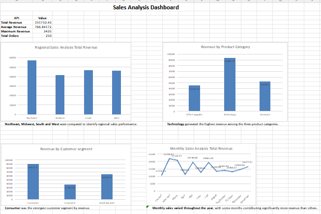

# Sales Analysis Dashboard using Microsoft Excel

## Project Overview

This project analyzes sales data using Microsoft Excel to identify revenue patterns and sales performance across different regions, product categories, customer segments, months, products and sales representatives.

## Objectives

- Analyze overall sales performance
- Calculate key revenue metrics
- Compare regional performance
- Analyze product categories and customer segments
- Identify monthly sales trends
- Build a sales dashboard
- Generate business insights from the data

## Tools Used

- Microsoft Excel
- Excel formulas
- Data visualization
- Dashboard design

## Key Analysis

- Total Revenue
- Average Revenue
- Maximum Revenue
- Total Orders
- Revenue by Region
- Revenue by Category
- Revenue by Customer Segment
- Monthly Sales Performance
- Product/Sales Representative Performance

## Key Findings

- Technology generated the highest revenue among the analyzed product categories.
- Consumer was the highest-revenue customer segment.
- Regional performance varied across Northeast, Midwest, South and West.
- Monthly revenue varied throughout the year.
- The dashboard provides a consolidated view of sales performance and helps identify high-performing areas.

## Dashboard

The final dashboard brings the major KPIs, charts and insights together in a single view for easier interpretation of sales performance.

## Conclusion
## Dashboard Preview

This project demonstrates the use of Microsoft Excel for data analysis, visualization and dashboard creation, transforming raw sales data into useful business insights.
